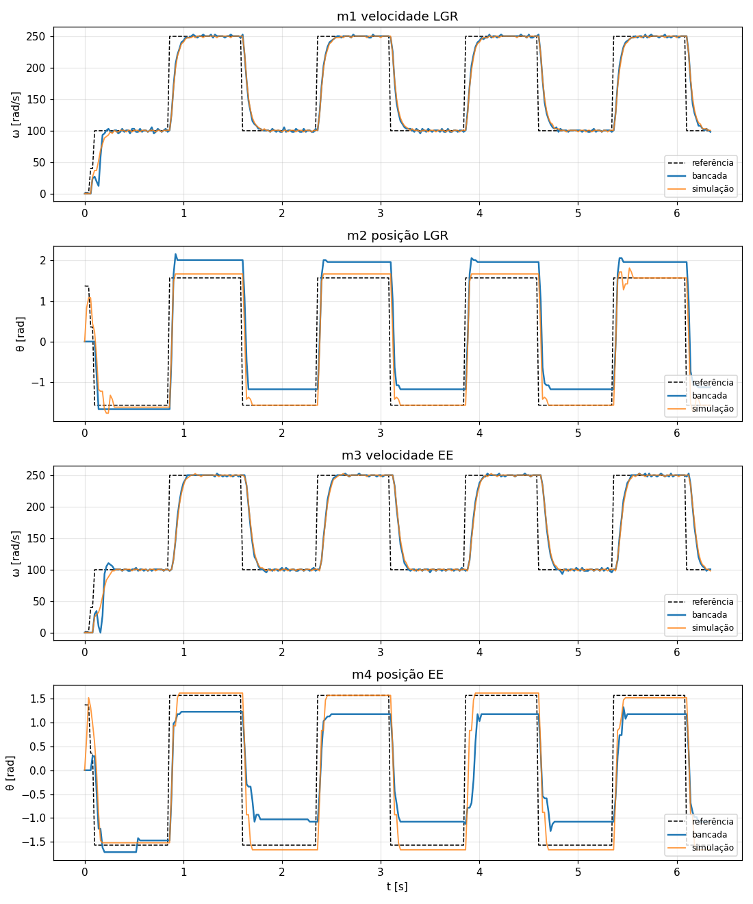
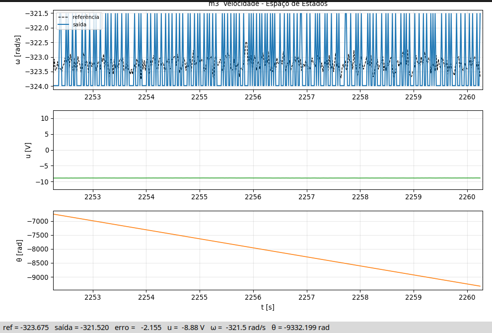
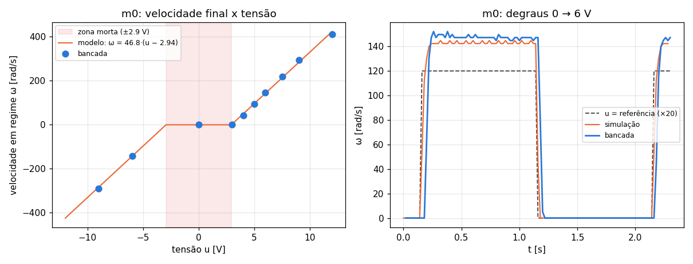
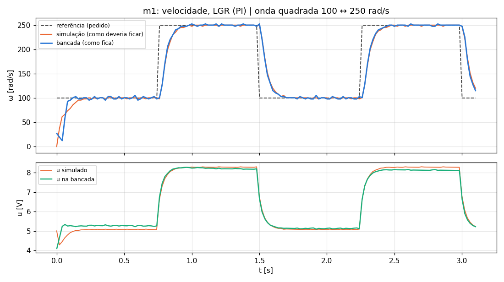
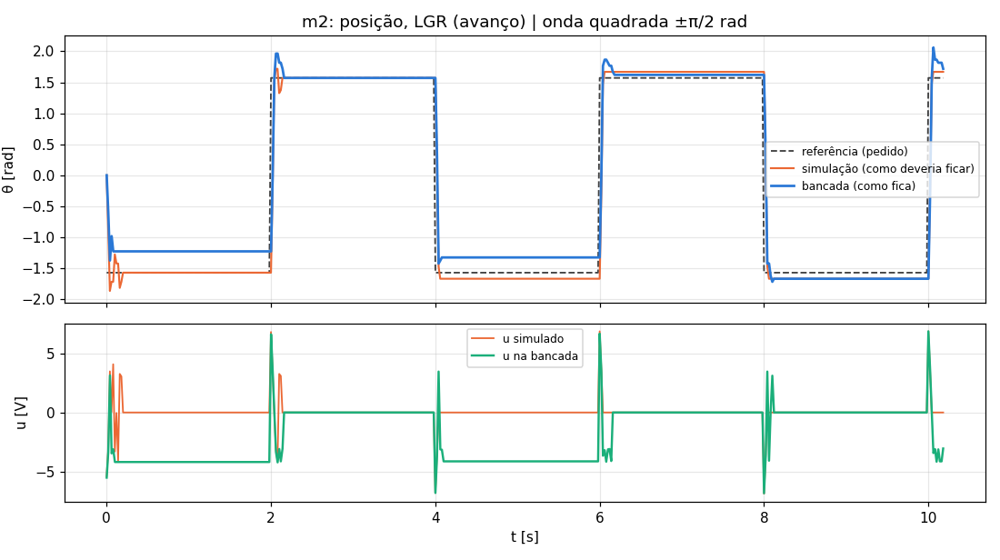
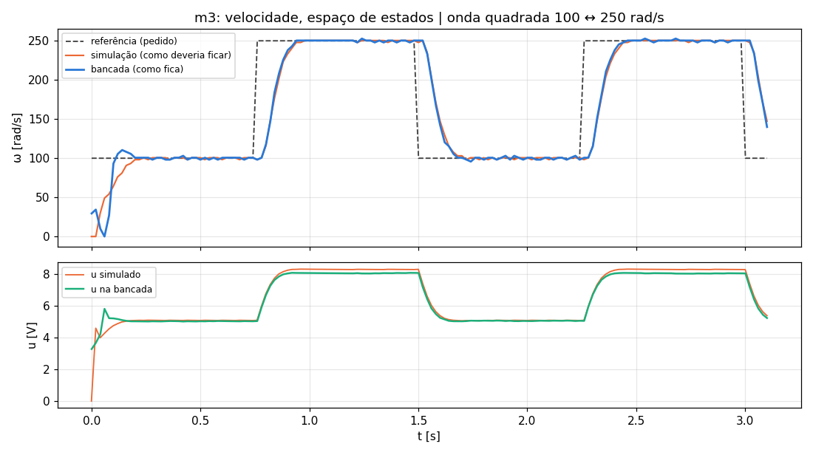
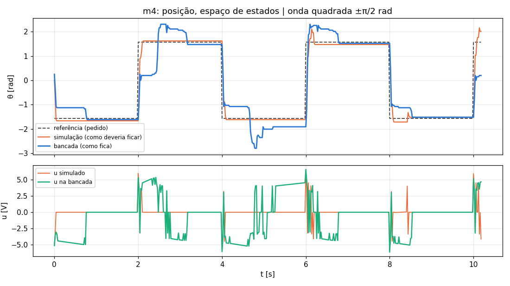
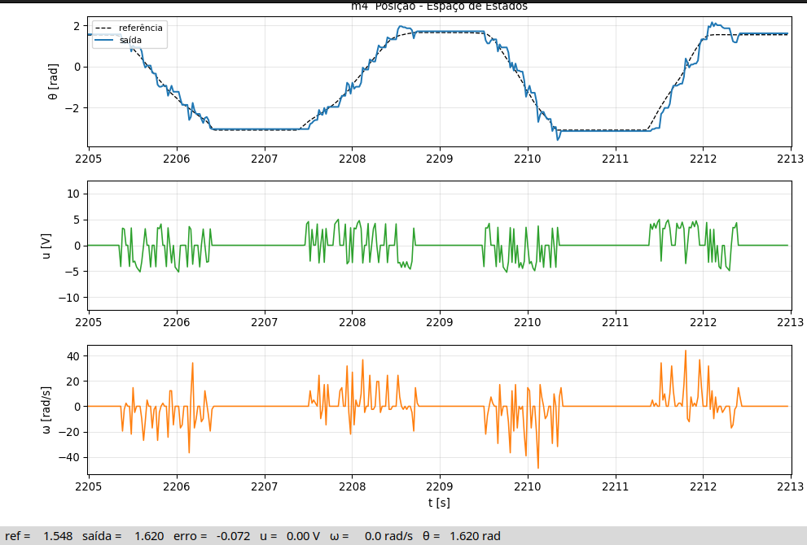
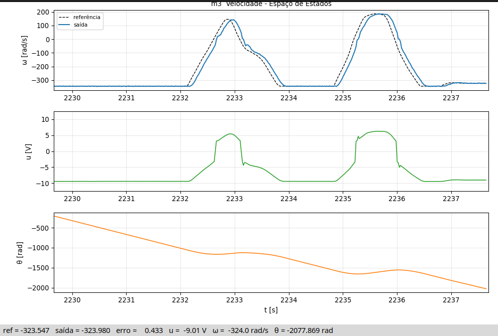
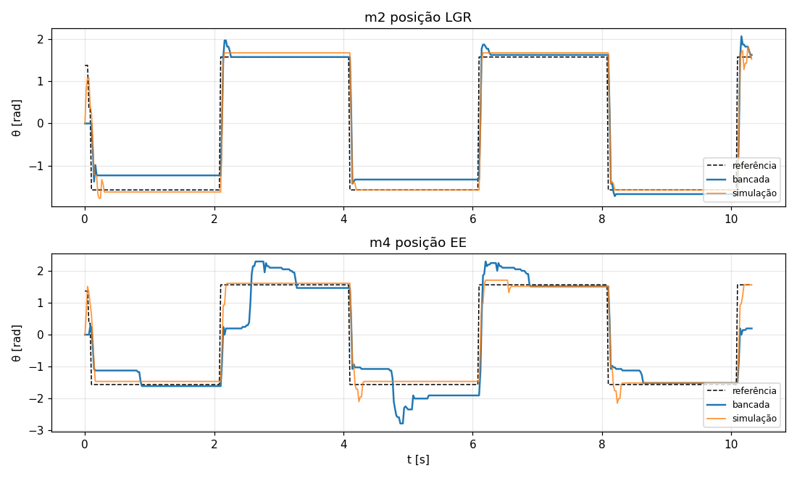

# Controle de motor DC: LGR e Espaço de Estados (bancada nº 5)

Firmware, interface gráfica e scripts de projeto para controlar **velocidade** e **posição**
de um motor DC com encoder. Tudo é feito de duas formas:

| Etapa | Abordagem | Velocidade | Posição |
|---|---|---|---|
| 1 | Funções de transferência, **Lugar Geométrico das Raízes (LGR)** | `m1`: PI discreto | `m2`: compensador de avanço |
| 2 | **Espaço de estados**, alocação de polos + integrador | `m3` | `m4` (observador opcional) |

Os quatro controladores ficam no mesmo firmware. Você troca entre eles e ajusta qualquer
ganho **pela serial, sem recompilar**, usando o painel gráfico (`interface/painel.py`).



> **Primeira vez na bancada? Comece pelo [Guia dos modos](#guia-dos-modos-m0-a-m4-o-que-fazem-e-o-que-esperar)**,
> logo abaixo: o que cada modo (m0 a m4) faz, o que esperar nos gráficos e no terminal, e as
> **perguntas que surgiram nos primeiros testes**, com resposta e interpretação. A instalação e o
> projeto vêm depois, a partir de [Estrutura do repositório](#estrutura-do-repositório).

---

## Sumário

**Guia dos modos (comece por aqui)**

1. [Resumo dos modos](#resumo-dos-modos) · [Como ler o terminal](#como-ler-a-telemetria-terminal) · [Ts = 20 ms](#o-período-de-amostragem-ts--20-ms)
2. [**Perguntas que surgiram nos primeiros testes**](#perguntas-que-surgiram-nos-primeiros-testes)
3. Modos: [m0](#m0-malha-aberta) · [m1](#m1-velocidade-lgr-pi) · [m2](#m2-posição-lgr-avanço) · [m3](#m3-velocidade-espaço-de-estados) · [m4](#m4-posição-espaço-de-estados) (cada um termina com as perguntas daquele modo)
4. [Seguindo o potenciômetro ao vivo](#seguindo-o-potenciômetro-ao-vivo-o-que-observar) · [Conclusão](#conclusão-o-que-comparar-no-relatório) · [Como reproduzir](#como-reproduzir)
5. Versão interativa, com gráficos em que dá para ler os valores: <https://tolonio.github.io/motor-Joca-teoria2/docs/modos.html>

**Projeto**

6. [Estrutura do repositório](#estrutura-do-repositório) · [Início rápido](#início-rápido) · [Como o sistema funciona](#como-o-sistema-funciona-resumo) · [Resultados na bancada](#resultados-na-bancada) · [Comandos da serial](#comandos-da-serial)
7. Documentação detalhada:
   - [docs/01-hardware.md](docs/01-hardware.md): circuito, encoder, PWM, potenciômetro, temporização
   - [docs/02-identificacao-e-lgr.md](docs/02-identificacao-e-lgr.md): **Etapa 1** passo a passo
   - [docs/03-espaco-de-estados.md](docs/03-espaco-de-estados.md): **Etapa 2** passo a passo
   - [docs/04-github.md](docs/04-github.md): como versionar e publicar este projeto no GitHub

---

## Guia dos modos m0 a m4: o que fazem e o que esperar

Esta seção explica, modo a modo, **o que o firmware faz**, **o que o potenciômetro controla**,
**como a onda deveria ficar** (simulação com o modelo da planta) e **como ela fica de verdade**
(ensaio gravado nesta bancada). O firmware tem **5 modos, de m0 a m4** (não existe m5).

As figuras são geradas por [`projeto/figuras_modos.py`](projeto/figuras_modos.py) a partir dos
ensaios em [`dados/`](dados). Em todas:

* **tracejado preto** = referência (o que foi pedido);
* **laranja** = simulação com o modelo não linear de [`projeto/planta.py`](projeto/planta.py)
  (atrito seco, saturação e encoder incluídos): **como deveria ficar**;
* **azul** = bancada: **como fica**;
* gráfico de baixo = **u**, a tensão aplicada no motor.

> **Versão interativa:** <https://tolonio.github.io/motor-Joca-teoria2/docs/modos.html>
> tem o mesmo conteúdo, com gráficos em que dá para ler os valores passando o mouse.

Cada modo termina com as **perguntas que surgiram usando a bancada**, com a resposta e a
interpretação.

## Resumo dos modos

| Modo | Controla | Potenciômetro define | Malha | Método | Resultado na bancada |
|---|---|---|---|---|---|
| m0 | tensão | −12 … +12 V | aberta | nenhum (u = ref) | parado abaixo de ~2,9 V; acima disso ω ≈ 46,8·(u − 2,94) rad/s |
| m1 | velocidade | −350 … +350 rad/s | fechada | LGR, PI | acomoda em ~0,14 s, sobressinal ~2 %, erro < 1 rad/s |
| m2 | posição | −π … +π rad | fechada | LGR, avanço | rápido (~0,1 s), mas pode parar até ~0,35 rad antes do alvo |
| m3 | velocidade | −350 … +350 rad/s | fechada | espaço de estados | igual ao m1 (~0,16 s, ~2 %) |
| m4 | posição | −π … +π rad | fechada | espaço de estados + integrador | chega mais perto do alvo, mas devagar e aos trancos |

### Como o potenciômetro vira referência

O potenciômetro é um divisor de tensão ligado em 0 V e 5 V, com o cursor no pino A6. A placa lê
0…4095 e converte para **−1…+1, com o zero no meio do curso**. Depois multiplica pela faixa do
modo (±12 V, ±350 rad/s ou ±π rad). O **sinal define o sentido de giro**: positivo aciona o pino
D10 da ponte H, negativo aciona o D9, e a corrente no motor se inverte. Por isso o motor gira para
um lado de um lado do meio e para o outro lado do outro.

### Como ler a telemetria (terminal)

Cada linha, a cada 20 ms: `t_ms,modo,referencia,u,velocidade,posicao`.

```
1502,1,250.000,8.219,247.89,206.5106
 │   │    │      │      │       └─ θ: posição acumulada do eixo (rad; 1 volta = 6,28 rad)
 │   │    │      │      └─ ω: velocidade medida (rad/s)
 │   │    │      └─ u: tensão aplicada (V, −12…+12)
 │   │    └─ referência: V no m0, rad/s no m1/m3, rad no m2/m4
 │   └─ modo (0…4)
 └─ tempo desde que a placa ligou (ms)
```

Linhas que começam com `#` são mensagens: `#ok m1` confirma um comando; `?` lista os parâmetros.

### Os três gráficos do painel

| Gráfico | m0, m1, m3 | m2, m4 |
|---|---|---|
| 1º | ω (pedido tracejado, real em azul) | θ (pedido tracejado, real em azul) |
| 2º | u [V] | u [V] |
| 3º | θ | ω |

### O período de amostragem: Ts = 20 ms

**20 ms = 0,02 s** é o "relógio" do controle. A cada 20 ms, ou seja, **50 vezes por segundo**, a
placa:

1. lê o potenciômetro (referência);
2. lê quantos pulsos o encoder contou desde a amostra anterior;
3. calcula θ, ω e o erro;
4. calcula a nova tensão u e aplica no motor (PWM);
5. envia uma linha de telemetria.

Por isso o tempo nas linhas do terminal avança de 20 em 20 ms. Para ter uma ideia de escala: a
324 rad/s, o eixo dá pouco mais de **1 volta a cada 20 ms** (6,5 rad).

### Por que ω aparece "em degraus" (onda quadrada no gráfico)

A velocidade não é medida diretamente. Ela é calculada pelos pulsos do encoder:

```
ω = (pulsos contados em 20 ms) × (2π / 128) / 0,02 s
```

Como o encoder só conta **pulsos inteiros**, a velocidade medida só pode assumir múltiplos de
**2π/128/0,02 = 2,45 rad/s**. Se a velocidade real fica entre dois desses valores, a medida
**alterna** entre eles. Exemplo real, no m3 com o potenciômetro em −323,5 rad/s:



```
t_ms     modo  ref      u       ω        θ
2260463, 3, -323.248, -8.870, -323.98, -9403.3271   ← 132 pulsos em 20 ms
2260483, 3, -323.034, -8.882, -321.52, -9409.7578   ← 131 pulsos em 20 ms
2260503, 3, -323.376, -8.875, -323.98, -9416.2373   ← 132 pulsos em 20 ms
```

* A velocidade real está entre −321,52 e −323,98 rad/s. Na maioria das amostras o encoder conta
  132 pulsos, às vezes 131, e o gráfico desenha uma "onda quadrada".
* **Essa onda é a resolução do sensor, não o motor oscilando.** A diferença é de 2,45 rad/s em
  323, ou **0,76 %**. A prova é o 2º gráfico: u fica praticamente constante (−8,88 V), ou seja, o
  controle não está reagindo a isso.
* Parece grande porque o painel ajusta a escala automaticamente. No print o eixo vertical vai de
  −324 a −321,5, uma janela de só 2,5 rad/s. Por isso o painel agora usa uma janela mínima de
  ±20 rad/s no gráfico de velocidade e de ±0,5 rad no de posição.
* O tracejado (referência) também treme um pouco: é o ruído de leitura do potenciômetro, menos de
  0,5 rad/s.

**Por que não medir melhor?** Com Ts maior o degrau diminuiria (com 40 ms seria 1,2 rad/s), mas o
controle ficaria mais lento e com mais atraso. É um compromisso. Os 20 ms vêm do firmware original,
e a decodificação 4x do encoder (128 contagens por volta em vez de 32) já deixou a medida 4 vezes
mais fina que a original, que tinha degraus de 9,8 rad/s ([01-hardware.md](docs/01-hardware.md)). Em
posição o efeito é o mesmo: θ só muda em passos de 2π/128 = **0,049 rad (2,8°)**.

---

## Perguntas que surgiram nos primeiros testes

Perguntas feitas usando a bancada pela primeira vez, com a resposta e a interpretação. As
perguntas de cada modo estão no fim da seção do modo.

#### "Nada muda quando giro o potenciômetro. O código não está funcionando?"

O código estava funcionando. Numa gravação de 40 s, a referência ficou parada em −1,1 V enquanto
o potenciômetro estava parado e, ao girá-lo, foi a −11,8 V e a +8,6 V, com o motor chegando a
415 rad/s. Dois motivos fazem parecer que "nada acontece":

* **Zona morta no m0.** A placa sempre inicia no m0 (malha aberta). Entre −3 V e +3 V, cerca de
  25 % do curso em volta do meio, o atrito não deixa o motor girar. Isso é esperado.
* **Porta errada no painel.** Se o computador tiver outros dispositivos seriais, o painel pode
  conectar no lugar errado. No notebook usado, a `/dev/ttyACM0` era um receptor GPS e nenhum dado
  chegava. A placa aparece como **USB CDC-Serial** (ttyACM1 ou ttyACM2). O painel agora escolhe
  essa porta sozinho, e o botão **↻** atualiza a lista se a placa reconectar com outro nome.

**Interpretação:** antes de suspeitar do código, confira a porta ("conectado em …" no painel) e
gire o potenciômetro além de ~25 % do curso a partir do meio.

#### "O que é esse potenciômetro? Por que o motor gira para os dois lados?"

É o botão giratório da bancada: um resistor com um contato deslizante, ligado entre 0 V e 5 V,
com o cursor no pino A6. A placa lê de 0 a 4095 e converte para **−1…+1, com o zero no meio do
curso**. Depois multiplica pela faixa do modo (±12 V, ±350 rad/s ou ±π rad).

O **sinal define o sentido de giro**: valor positivo aciona o pino D10 da ponte H, valor negativo
aciona o D9, e a corrente no motor se inverte. Por isso, de um lado do meio o motor gira num
sentido e do outro lado inverte.

#### "Acho que o zero não está exatamente no meio do potenciômetro. Precisa calibrar?"

Sim. Nos testes, o lado **negativo** chega perto do fim da faixa (−3,1 de −3,14 rad), mas o
**positivo** para em cerca da **metade** (+1,55 rad, e +190 de +350 rad/s). Numa das pontas o
cursor não chega a 0 V, então o meio físico do potenciômetro fica em torno de −25 % da faixa.
Detalhes em [Observação: o lado positivo do potenciômetro…](#observação-o-lado-positivo-do-potenciômetro-não-chega-ao-fim-da-faixa).

**Interpretação:** o código assume que o potenciômetro vai de 0 V a 5 V. A correção é calibrar:
medir o valor real das duas pontas (no m0, girando até o fim e lendo `ref` no painel) e mapear essa
faixa para −1…+1, com uma pequena zona neutra no centro.

#### "Tem como ver as saídas no terminal? Onde eu digito os comandos?"

1. No terminal do VS Code, na pasta do projeto, rode `python3 interface/painel.py`.
2. Clique em **Conectar**. Cada linha que chega da placa também aparece nesse terminal
   (50 por segundo). Não feche o terminal: o painel fecha junto.
3. Os comandos (`m1`, `p`, `z`, `?`…) vão no campo **Comando:**, embaixo na janela do painel, e
   são enviados com Enter. A placa confirma com `#ok …`.

Sem o painel: `pio device monitor --echo`. Feche o painel antes, porque a porta serial só pode
ser usada por um programa de cada vez.

#### "O que é cada saída do terminal?"

```
33603,0,-5.382,-5.382,0.00,-3453.8376
```

| Valor | Significado |
|---|---|
| `33603` | tempo desde que a placa ligou: 33,6 s |
| `0` | modo m0 |
| `-5.382` | referência: o que foi pedido (V no m0, rad/s no m1/m3, rad no m2/m4) |
| `-5.382` | u: tensão aplicada no motor (no m0 é igual à referência) |
| `0.00` | ω: velocidade medida (aqui, parado) |
| `-3453.8376` | θ: posição acumulada; o eixo já deu ~550 voltas desde que a placa ligou |

Linhas que começam com `#` são mensagens: `#ok m1` confirma um comando; `?` lista os parâmetros
(`#cv`, `#ep`, `#zm`…).

**Interpretação deste exemplo:** pediu −5,38 V e o motor está parado. Com mais de 3 V ele deveria
girar. Se ω continua 0, o mais provável é a fonte de 12 V da ponte H estar desligada.

#### "Quero ver dados que já passaram e salvar um pedaço do histórico."

O painel guarda os últimos **30 min** na memória:

* **⏸ Pausar gráfico** congela a tela; os dados continuam sendo guardados.
* Na barra acima dos gráficos, a **cruz** arrasta o gráfico para o passado e a **lupa** dá zoom.
* **Salvar trecho visível** grava em CSV o intervalo que está na tela; **Salvar últimos N s**
  grava os últimos N segundos. Os arquivos vão para `dados/`.
* **▶ Voltar ao vivo** retoma. Ao fechar o painel o histórico se perde, então salve antes.

---

## m0: malha aberta

**O que faz:** aplica no motor exatamente a tensão pedida (`u = referência`). Não mede nada para
corrigir. Se você frear o eixo com a mão, ninguém compensa.

**Para que serve:** identificar a planta. Foi daqui que saíram K = 46,75 rad/s/V, τ = 19,4 ms e o
atrito seco V0 = 2,94 V ([02-identificacao-e-lgr.md](docs/02-identificacao-e-lgr.md)).



**Como deveria ficar:** reta `ω = K·(u − V0)` fora da zona morta e ω = 0 dentro dela. Num degrau,
a velocidade sobe como uma exponencial de constante τ ≈ 19 ms, ou seja, chega ao valor final em
~0,06 s.

**Como fica:** os pontos medidos caem em cima da reta (à esquerda). No degrau de 6 V (à direita),
a bancada chega a ~147 rad/s e a simulação a ~143 rad/s, com a mesma rapidez. Com 3 V o motor
**não gira**: é a zona morta.

**O que você vê no painel:** perto do meio do potenciômetro (|u| < ~3 V) nada acontece. Acima
disso a velocidade cresce proporcional à tensão. No 1º e no 2º gráfico, referência e u são a mesma
curva.

```
1600,0,6.000,6.000,149.72,63.2736      ← pediu 6 V, aplicou 6 V, girando a ~150 rad/s
```


### Perguntas sobre o m0

#### "Quando coloco a mão no eixo girando, não era para acontecer algo?"

No m0, **não**. A velocidade cai e **fica baixa**, e u não muda, porque a placa não olha o
resultado. É exatamente o que significa malha aberta.

**Interpretação:** faça o mesmo teste no m1 e compare. A diferença entre os dois é o controle
trabalhando. No m0, o "erro" mostrado no painel não tem significado: ele compara volts com rad/s.

---

## m1: velocidade, LGR (PI)

**O que faz:** a cada 20 ms mede ω, calcula o erro `e = r − ω` e aplica um PI discreto,
`C(z) = 0,01007 (z − 0,357)/(z − 1)`, projetado pelo Lugar Geométrico das Raízes. O "P" reage ao
erro do momento; o "I" acumula o erro até zerá-lo. O firmware também soma a compensação de atrito
(`zm`/`zs`), para o controlador "enxergar" uma planta linear.



**Como deveria ficar:** ω alcança a referência em ~0,14 s, com sobressinal de ~2 % e erro em
regime zero (graças ao integrador).

**Como fica:** **praticamente igual à simulação.** Em regime, u ≈ 5,3 V para 100 rad/s e ≈ 8,2 V
para 250 rad/s. A curva azul "treme" em passos de 2,45 rad/s: é a resolução do encoder
(1 contagem a cada 20 ms), não erro do controle.

**Experimente:** freie o eixo levemente com o dedo. ω cai um pouco, u sobe sozinho e ω volta para
a referência.

```
1502,1,250.000,8.219,247.89,206.5106   ← pediu 250 rad/s, está a 247,9 com 8,2 V
```


### Perguntas sobre o m1

#### "O que o m1 faz? O que eu vejo nele?"

O m1 controla a **velocidade**. O potenciômetro define quão rápido o eixo deve girar (−350 a
+350 rad/s; 350 rad/s ≈ 3 340 rpm). A cada 20 ms a placa:

```
1. lê o potenciômetro           → velocidade desejada, ex.: 200 rad/s
2. mede a velocidade no encoder → velocidade real, ex.: 180 rad/s
3. calcula o erro               → 200 − 180 = 20 rad/s
4. o PI decide a tensão:
     P (proporcional): erro grande → empurra forte
     I (integral):     se o erro persiste, aumenta a tensão aos poucos até zerar o erro
5. aplica a tensão e volta ao passo 1
```

No painel: 1º gráfico, a linha azul (real) deve alcançar e seguir a tracejada (pedida); 2º
gráfico, u, o esforço do controle; 3º gráfico, θ, que sobe sem parar enquanto o eixo gira.

Experimentos:

1. **Seguir o potenciômetro:** gire devagar; a velocidade real acompanha, inclusive em
   velocidades baixas (a compensação de atrito ajuda a vencer a zona morta).
2. **Resposta ao degrau:** **Enviar onda quadrada** (100 ↔ 250 rad/s, 750 ms). Meça o tempo de
   subida, o sobressinal e o erro em regime. Pause e use a lupa; **Salvar trecho visível** guarda
   o ensaio para o relatório.
3. **Saturação:** perto de ±350 rad/s, u bate em ±12 V. O motor não passa de ~420 rad/s, então
   acima disso o erro não zera.

Perto de zero a velocidade fica "pulando": em baixa velocidade o atrito domina, e a medida tem
degraus de 2,45 rad/s ([por quê](#por-que-ω-aparece-em-degraus-onda-quadrada-no-gráfico)).

#### "Quando coloco a mão no eixo girando, não era para acontecer algo?"

Sim, e no m1 é onde aparece melhor:

1. a velocidade cai e o **erro** aparece (pedida − real);
2. **u sobe** no 2º gráfico e você sente o motor fazer mais força;
3. pelo integrador, a velocidade **volta para o valor pedido** mesmo com a mão lá; só u fica mais
   alto;
4. se você frear muito, u chega a **12 V** (o máximo) e o erro não zera.

**Interpretação:** é a rejeição de perturbação da malha fechada. O integrador garante erro zero em
regime para uma carga constante, enquanto u não saturar. Se u **não** subir quando você freia,
algo está errado.

> Cuidado: a 300–400 rad/s o eixo gira a mais de 3 000 rpm. Freie de leve, de lado, com um pano
> ou o dedo, nunca segurando forte.

---

## m2: posição, LGR (avanço)

**O que faz:** mede θ e aplica um compensador de avanço, `C(z) = 0,897 (z − 0,357)/z`. O eixo se
comporta como um servo: vai até o ângulo pedido e para. Quando |erro| < 0,1 rad (`bp`), o controle
desliga, para o motor não ficar "caçando" o alvo.

> Antes de usar o m2 ou o m4, clique em **Zerar posição (z)**. Sem isso, o controle tenta
> "desenrolar" todas as voltas acumuladas desde que a placa ligou.



**Como deveria ficar:** o eixo chega ao alvo em ~0,1 s, com um pequeno sobressinal, e para.

**Como fica:** o movimento é rápido como o previsto, mas **em t ≈ 0 s e t ≈ 4 s o eixo parou
antes do alvo** (erro de 0,25 a 0,35 rad), com u ≈ −4,2 V "empurrando" sem conseguir mover. O
atrito estático desta bancada varia de 2,4 V a 5,7 V conforme o ângulo
([figura](docs/figuras/atrito_estatico.png)), e o avanço **não tem integrador** para aumentar a tensão
até vencê-lo. Nos outros degraus ele chegou a menos de 0,1 rad.

```
2041,2,-1.571,-4.198,0.00,-1.2272      ← pediu −1,571 rad, parou em −1,227 com −4,2 V: preso pelo atrito
```


### Perguntas sobre o m2

#### "Quando coloco a mão no eixo, não era para acontecer algo?"

Segure o eixo ou tire-o do lugar: se você o desloca mais de ~6° (0,1 rad), o motor empurra de
volta para o ângulo pedido, com força proporcional ao deslocamento. Abaixo de 6° ele não reage: é
a tolerância `bp`, ignorada de propósito para o motor não ficar tremendo em volta do alvo.

**Interpretação:** sem integrador, a força não cresce com o tempo. Se o atrito segurar o eixo um
pouco fora do alvo, ele fica lá (é o erro de 0,25 a 0,35 rad visto na figura acima). Compare com o
m4.

---

## m3: velocidade, espaço de estados

**O que faz:** mesmo objetivo do m1, outro método (Etapa 2). Realimentação de estado mais um
integrador do erro: `u = −k1·ω + ki·∫(r − ω) dt`, com k1 = 0,00669 e ki = 0,295. Os polos foram
alocados (Ackermann) no mesmo lugar do polo dominante do PI, para os dois serem comparáveis
([03-espaco-de-estados.md](docs/03-espaco-de-estados.md)).



**Como deveria ficar / como fica:** igual ao m1 (acomodação ~0,16 s, sobressinal ~2 %, erro
< 1 rad/s), e bancada e simulação coincidem. A diferença para o m1 está em u no instante do
degrau: aqui a referência entra só pelo integrador, então u sobe de forma mais suave.

```
1502,3,250.000,8.044,250.35,199.8347
```


### Perguntas sobre o m3

#### "Quanto valem os tais 20 ms?"

É o período de amostragem, Ts = 0,02 s: 50 ciclos de leitura, cálculo e atuação por segundo.
Veja [O período de amostragem](#o-período-de-amostragem-ts--20-ms).

#### "Por que ω está variando tanto? Por que a onda tem esse formato?"


Ela quase não varia: o eixo vertical vai só de −324 a −321,5 rad/s. A medida alterna entre 132 e
131 pulsos do encoder por amostra (−323,98 e −321,52 rad/s), porque a velocidade real fica entre
os dois. É a **resolução do sensor** (0,76 %), e não o motor oscilando: u fica constante em
−8,88 V. Explicação completa em
[Por que ω aparece "em degraus"](#por-que-ω-aparece-em-degraus-onda-quadrada-no-gráfico).

#### "O que devo observar seguindo o potenciômetro?"

ω segue a referência com ~0,1 s de atraso, u acompanha a velocidade e θ acumula voltas. Veja
[m3: velocidade seguindo o potenciômetro](#m3-velocidade-seguindo-o-potenciômetro).

---

## m4: posição, espaço de estados

**O que faz:** `u = k1·(r − θ) − k2·ω + ki·∫(r − θ) dt`, com k1 = 0,650, k2 = 0,00965 e
ki = 2,06. Usa posição **e** velocidade, mais um integrador. Tem um observador opcional que estima
a velocidade a partir do modelo; ele vem desligado (`oe 0`) e o comando `oe 1` liga.



**Como deveria ficar:** a simulação (com atrito fixo) chega perto do alvo em ~0,2 s e para.

**Como fica:** aqui bancada e simulação **diferem bastante**. Quando o eixo para antes do alvo,
o integrador vai aumentando u até o motor "descolar". Ele então dá um tranco e muitas vezes passa
do alvo (em t ≈ 2,5 s chegou a 2,3 rad para um alvo de 1,57). Isso é o **stick-slip**: o atrito
estático real varia com o ângulo e é bem maior que o atrito em movimento, coisa que o modelo com
atrito fixo não reproduz. Quando acerta, o erro final fica em ~0,05 rad, menor que no m2. Mas leva
de 1 a 2 s e nem sempre converge dentro do patamar (em t ≈ 4–6 s ficou a 0,34 rad).

```
8042,4,1.571,0.000,0.00,1.5217         ← chegou a 0,05 rad do alvo e desligou (dentro da banda de 0,1 rad)
```


### Perguntas sobre o m4

#### "No m4 ele mal responde quando mexo no potenciômetro. Está certo isso?"

Em boa parte, sim. O m4 é o modo mais lento da bancada:

* o curso todo do potenciômetro equivale a só **uma volta** do eixo (±π rad), então mexidas
  pequenas pedem ângulos pequenos;
* erros menores que **0,1 rad (~6°)** são ignorados de propósito (`bp`);
* com erro pequeno, a tensão não vence o atrito estático (2,4 a 5,7 V nesta bancada), e o
  integrador leva **1 a 2 s** para aumentar u até o eixo descolar.

**Como confirmar:** observe u. Se ele fica entre 4 e 6 V, subindo, enquanto θ não muda, é o
atrito segurando e o integrador "carregando". Para uma resposta mais viva, teste `zr 20` (rampa
de partida: a compensação sobe 20 V/s enquanto o motor está preso) ou `bp 0.05`.

#### "Acho que demorou para mudar de m3 para m4."

A troca de modo é imediata: vale na amostra seguinte, e a placa responde `#ok m4`. A demora vem
da **posição acumulada no m3**: girando a 100 rad/s por 10 s, θ soma ~1 000 rad (160 voltas). Ao
entrar no m4, o controle quer levar θ até o ângulo do potenciômetro (entre −π e +π) e precisa
**desenrolar todas essas voltas**.

**Interpretação:** clique em **Zerar posição (z)** ao passar de um modo de velocidade para um de
posição. Num print logo depois da troca, a tela mostrava ref = −1,833, θ = −1,767, erro = −0,066 e
u = 0. Estava certo: o erro estava dentro da tolerância de 0,1 rad e o controle desligou o motor.

#### "Está certo esse −2 a 2? Por que fica tão baixo?"



O controle está certo: θ (azul) segue a referência em degraus (stick-slip), u só aparece em
rajadas de ±5 V enquanto o potenciômetro se move, e volta a 0 quando o erro fica abaixo de
0,1 rad (no fim: ref 1,548, θ 1,620, erro −0,072).

A **faixa** é que está errada: deveria ir de −3,14 a +3,14 rad, mas vai de −3,1 a só **+1,55**. O
lado positivo do potenciômetro não chega ao fim. Veja a pergunta sobre calibração em
[Perguntas que surgiram nos primeiros testes](#perguntas-que-surgiram-nos-primeiros-testes).

---

## Seguindo o potenciômetro ao vivo: o que observar

As figuras acima usam ondas quadradas. Abaixo estão dois registros do painel com a referência
vindo do **potenciômetro**, girado à mão de uma ponta à outra.

### m4: posição seguindo o potenciômetro


* **θ (azul) acompanha a referência (tracejado), mas em degraus.** O eixo "gruda", o erro cresce,
  o controle aumenta u até ele descolar, e ele anda de tranco. É o mesmo stick-slip da onda
  quadrada, agora em câmera lenta.
* **u só aparece enquanto o potenciômetro se move.** São rajadas de ±5 V (controle mais
  compensação de atrito). Com o potenciômetro parado e o erro menor que 0,1 rad (`bp`), **u = 0**
  e o motor fica desligado. Na linha de baixo: ref = 1,548, θ = 1,620, erro = −0,072 rad (4°),
  u = 0. Está dentro da tolerância, então o comportamento está correto.
* **ω (3º gráfico) só tem picos curtos**, de ±40 rad/s: são os trancos.
* **A faixa vai de −3,1 a +1,55 rad, e não de −π a +π.** Veja a observação sobre o potenciômetro
  logo abaixo.

### m3: velocidade seguindo o potenciômetro



* **ω (azul) segue a referência com um atraso de ~0,1 s.** É a acomodação de ~0,16 s vista no
  degrau, aplicada a uma referência que muda continuamente.
* **u acompanha a velocidade:** cerca de −9 V para −324 rad/s e +6 V para +190 rad/s. Pelo modelo,
  ω ≈ 46,8·(u − 2,94), então 324 rad/s precisam de ~9,9 V. A diferença é a compensação de atrito e
  o integrador.
* **θ (3º gráfico) desce sem parar:** em velocidade o eixo gira continuamente e a posição acumula
  voltas (−2 078 rad ≈ 330 voltas). Por isso, **ao trocar de m3 para m4 o motor demora a parar**:
  ele "desenrola" essas voltas até chegar ao ângulo do potenciômetro. Clique em **Zerar posição (z)**
  ao passar de um modo de velocidade para um de posição.
* Erro na linha de baixo: 0,43 rad/s em 324 rad/s (0,1 %).

### Observação: o lado positivo do potenciômetro não chega ao fim da faixa

Nos dois registros, o lado **negativo** chega perto do máximo (−3,1 de −3,14 rad, e −323 de
−350 rad/s). Já o **positivo** para em cerca da **metade** (+1,55 de +3,14 rad, e +190 de
+350 rad/s). Isso indica que, na ponta "positiva", o cursor do potenciômetro não chega a 0 V
(lê ~1 000 em vez de 0, na escala de 0 a 4095). Consequências:

* o **meio físico** do potenciômetro não corresponde à referência zero (fica em torno de −25 % da
  faixa), e é por isso que "o zero não está no meio";
* no m2/m4 só dá para pedir até ~+π/2 rad no sentido positivo; no m1/m3, até ~+175 rad/s.

O código não está errado: ele assume que o potenciômetro vai de 0 V a 5 V. A correção é
**calibrar** as duas pontas (ler o valor real em cada uma e mapear essa faixa para −1…+1), mais
uma pequena zona neutra no centro. Para medir, use o **m0**, gire até cada ponta e anote o valor de
`ref` no painel.

---

## Conclusão: o que comparar no relatório

* **Velocidade (m1 × m3):** os dois métodos dão a mesma resposta, e a simulação prevê a bancada
  muito bem. O modelo de 1ª ordem com compensação de atrito é suficiente.
* **Posição (m2 × m4):** quem domina é o **atrito estático**. Sem integrador (m2) o eixo é rápido,
  mas para onde o atrito deixar. Com integrador (m4) chega mais perto do alvo, ao custo de
  lentidão e trancos. A rampa de partida (`zr`, que sobe a compensação enquanto o motor está preso)
  e o script [`projeto/teste_posicao.py`](projeto/teste_posicao.py), que testa vários alvos
  aleatórios, servem para estudar esse compromisso.

## Como reproduzir

Pelo painel (`python interface/painel.py`): escolha o modo, clique em **Zerar posição (z)** se for
posição, e use **Enviar onda quadrada** com os valores padrão de cada modo (100 ↔ 250 rad/s, ou
±1,5708 rad). Use **⏸ Pausar gráfico** para voltar no tempo e **Salvar trecho visível** para
guardar o ensaio em CSV.

Pela linha de comando (sem o painel):

```bash
cd projeto
python ensaio.py "m1;q100,250,750" 6 -o ../dados/meu_m1.csv
python ensaio.py "z;m2;q-1.5708,1.5708,2000" 10 -o ../dados/meu_m2.csv
python compara.py ../dados/meu_m1.csv      # sobrepõe simulação e bancada
python figuras_modos.py                    # refaz as figuras deste documento
```

---

## Estrutura do repositório

```
controle_motor/
├── src/main.cpp            firmware (PlatformIO / Arduino): os 5 modos de controle
├── platformio.ini          placa LGT8F328P, porta serial, biblioteca TimerOne
├── interface/painel.py     painel gráfico: gráficos ao vivo, histórico de 30 min, botões, ganhos, CSV
├── projeto/
│   ├── planta.py           modelo da planta + simulador não linear (usado por todos)
│   ├── identificacao.py    obtém K, τ e a zona morta a partir de ensaios em malha aberta
│   ├── lgr.py              ETAPA 1: projeto por LGR no plano z
│   ├── espaco_estados.py   ETAPA 2: alocação de polos (Ackermann) + observador
│   ├── compara.py          sobrepõe simulação e dados da bancada
│   ├── figuras_modos.py    figuras do guia dos modos (simulação x bancada, m0 a m4)
│   ├── ensaio.py           ensaios automáticos pela linha de comando, sem o painel
│   └── teste_posicao.py    teste estatístico do controle de posição (alvos aleatórios)
├── dados/                  ensaios gravados (CSV)
├── docs/                   explicações e figuras
└── backup/                 firmware ORIGINAL da bancada (.hex) para restaurar
```

## Início rápido

### 1. Instalar o software

```bash
# PlatformIO (compila e grava o firmware). No VS Code basta instalar a extensão "PlatformIO IDE".
pip install platformio

# Python para a interface e os scripts de projeto
pip install -r requirements.txt
```

> **Linux:** para acessar a porta serial sem `sudo`, rode `sudo usermod -aG dialout $USER`
> e faça logout/login.

### 2. Gravar o firmware

Ajuste `upload_port`/`monitor_port` em [platformio.ini](platformio.ini) (`/dev/ttyACM1` no Linux,
`COM5` etc. no Windows) e rode:

```bash
pio run -t upload
```

### 3. Abrir o painel

```bash
python interface/painel.py
```

Escolha a porta e clique em **Conectar**. A placa reinicia e o painel lê os ganhos atuais.
Em seguida, escolha o modo (m0 a m4), a referência (potenciômetro, valor fixo ou onda quadrada)
e acompanhe os gráficos. **● Gravar** salva um CSV em `dados/`.

* O painel escolhe sozinho a porta da placa (chip USB 1A86, "USB CDC-Serial"). Se houver outros
  dispositivos seriais (GPS, modem), confira a porta. Se a placa reconectar com outro nome, clique em **↻**.
* Cada linha recebida também é impressa no terminal que abriu o painel (formato em
  [Como ler a telemetria](#como-ler-a-telemetria-terminal)). Comandos vão no campo **Comando:**.
* **Histórico:** o painel guarda os últimos 30 min. **⏸ Pausar gráfico** congela a tela; a lupa e a
  cruz da barra acima dos gráficos dão zoom e arrastam para o passado. **Salvar trecho visível** ou
  **Salvar últimos N s** gravam esse pedaço em `dados/`.

### 4. Refazer o projeto (opcional, mas é o trabalho!)

```bash
cd projeto
python identificacao.py      # 1) modelo da planta a partir de dados/degrau_malha_aberta_*.csv
python lgr.py                # 2) Etapa 1: imprime os comandos "cv ..." e "cp ..."
python espaco_estados.py     # 3) Etapa 2: imprime "ev ...", "ep ...", "ob ..."
python compara.py            # 4) simulação x bancada
```

Cole os comandos impressos no campo **Comando** do painel (ou nos campos de parâmetros).

## Como o sistema funciona (resumo)

```
 potenciômetro ─┐                         ┌──────────── Ts = 20 ms ─────────────┐
 serial (r, q) ─┴─► referência r ──► (+)─►│ controlador (m1..m4) │─► u (V) ─► PWM ─► ponte H ─► motor
                                      ▲ - └──────────────────────┘                          │
                                      │                                                       │
                                      └──── θ (rad), ω (rad/s) ◄── contagem do encoder ◄──────┘
```

* **Medida:** o encoder tem 32 pulsos por volta no canal A. Contando as **4 bordas** dos canais A e B
  (decodificação 4x), a contagem chega a **128 por volta**: θ = contagem·2π/128 e
  ω = Δcontagem·2π/(128·Ts). A resolução de ω é de 2,45 rad/s (4x melhor que no firmware original).
* **Atuação:** u ∈ [−12, 12] V vira PWM de 3 kHz: u > 0 aciona o pino D10 e u < 0 aciona o D9
  (as duas entradas da ponte H).
* **Planta identificada:** `W(s)/U(s) = 46,8 / (0,0195 s + 1)` rad/s/V, com **atrito seco**
  (o motor só sai do lugar acima de ~2,9 V girando, ou ~3,5 a 5 V parado).
* **Por que projetar no plano z:** τ ≈ 20 ms é igual a Ts, então não dá para tratar o controle
  como "quase contínuo". Os dois projetos discretizam a planta (ZOH) e trabalham direto em z.
* **Compensação de atrito:** o firmware soma `zm` (girando) ou `zs` (parado) volts no sentido de u.
  Assim o controlador "enxerga" uma planta quase linear, que é a hipótese do projeto.

Os detalhes e o *porquê* de cada escolha estão em [docs/](docs/).

## Resultados na bancada

| Modo | Controlador | Resultado (degrau 100→250 rad/s ou ±π/2 rad) |
|---|---|---|
| m1 | PI `C(z) = 0,01007 (z − 0,357)/(z − 1)` | acomodação (5 %) ≈ 0,14 s, sobressinal ≈ 2 %, erro em regime < 1 rad/s |
| m3 | EE `u = −0,00669 ω + 0,295 ∫e` | acomodação ≈ 0,16 s, sobressinal ≈ 2 %, erro < 1 rad/s |
| m2 | Avanço `C(z) = 0,897 (z − 0,357)/z` | rápido (≈ 0,1 s), mas **para onde o atrito deixar**: erro de 0 a 0,4 rad |
| m4 | EE `u = 0,65 (r − θ) − 0,0096 ω + 2,06 ∫e` | o integrador leva o erro a 0,05–0,1 rad, mas devagar (≈ 1–2 s) |

Na **velocidade**, simulação e bancada praticamente coincidem. Na **posição**, o resultado é
limitado pelo **atrito estático**, que varia com o ângulo do eixo. Isso é uma conclusão importante
do trabalho: um controlador sem integrador (m2) não corrige o erro deixado pelo atrito, e o
integrador (m4) corrige, ao custo de *stick-slip*. A discussão completa está em
[docs/03-espaco-de-estados.md](docs/03-espaco-de-estados.md#5-o-que-aconteceu-na-bancada-e-por-quê).



## Comandos da serial

Uma linha por comando, terminada em Enter (o painel faz isso por você).

| Comando | Efeito |
|---|---|
| `m0` … `m4` | modo: 0 malha aberta, 1 vel. LGR, 2 pos. LGR, 3 vel. EE, 4 pos. EE |
| `l` / `d` | liga / desliga o motor |
| `p` | referência pelo potenciômetro (±12 V, ±350 rad/s ou ±π rad, conforme o modo) |
| `r<valor>` | referência fixa, ex.: `r150` |
| `q<a>,<b>,<ms>` | onda quadrada entre a e b, meio período em ms, ex.: `q100,250,750` |
| `z` | zera a posição |
| `cv b0,b1,b2,a1,a2` | C(z) de velocidade: `(b0 + b1 z⁻¹ + b2 z⁻²)/(1 + a1 z⁻¹ + a2 z⁻²)` |
| `cp b0,b1,b2,a1,a2` | C(z) de posição |
| `ev k1,ki,nv` | EE velocidade: `u = −k1 ω + ki xi + nv r` |
| `ep k1,k2,ki` | EE posição: `u = k1 (r − θ) − k2 ω + ki xi` |
| `ob L1,L2` / `oe 0\|1` | ganhos do observador / desliga-liga o observador |
| `pl K,tau` | modelo da planta usado pelo observador |
| `zm V` / `zs V` | compensação de atrito girando / parado |
| `zr V/s` | rampa de partida: com o motor preso, a compensação sobe zr V/s (até 7 V); 0 desliga |
| `bp rad` | banda morta do erro de posição |
| `?` | imprime todos os parâmetros |

Telemetria (50 Hz): `t_ms,modo,referencia,u,velocidade,posicao`.

## Restaurar o firmware original

Ver [backup/README.md](backup/README.md).
