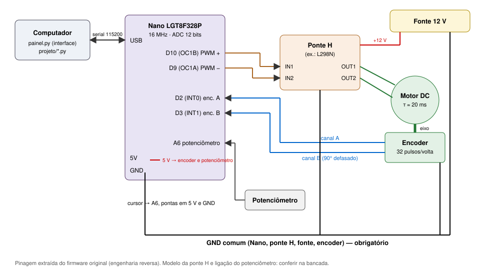

# 1. Hardware e funcionamento do código

Este documento cobre a primeira parte da Etapa 1: **como o código lê o encoder e o potenciômetro
e como aciona o motor por PWM**.



> A pinagem acima foi **extraída do firmware original** da bancada (engenharia reversa do `.hex`,
> ver [backup/README.md](../backup/README.md)) e confirmada nos ensaios. O modelo da ponte H e a
> forma como o potenciômetro está ligado não aparecem no código: confira na bancada.

## 1.1 Componentes e ligações

| Parte | Pino | Função |
|---|---|---|
| Nano **LGT8F328P** (clone do ATmega328P) | USB | alimentação 5 V, gravação e comunicação serial (115200 baud) |
| Encoder canal A | **D2** (INT0) | interrupção a cada borda |
| Encoder canal B | **D3** (INT1) | interrupção a cada borda |
| Ponte H, entrada 1 | **D10** (OC1B) | PWM quando u > 0 |
| Ponte H, entrada 2 | **D9** (OC1A) | PWM quando u < 0 |
| Potenciômetro (cursor) | **A6** | referência manual |
| Fonte 12 V | ponte H | potência do motor |

**Por que o GND tem que ser comum:** o PWM sai do Nano referenciado ao GND dele. Se a ponte H e a
fonte de 12 V não compartilharem esse GND, a ponte não "entende" o nível lógico e o motor não gira
ou gira de forma errática.

## 1.2 Encoder em quadratura: posição e velocidade

O encoder gera duas ondas quadradas, A e B, **defasadas de 90°**. O sentido de giro é dado por
qual delas "chega primeiro":

```
sentido -1:  A  _|‾‾‾|___|‾‾‾|__          estados (A,B): 00 → 01 → 11 → 10 → 00 ...
             B  ‾‾|___|‾‾‾|___|‾
sentido +1:  a mesma sequência ao contrário: 00 → 10 → 11 → 01 → 00 ...
```

**Firmware original:** interrupção só na borda de subida de A, lendo B para saber o sentido.
São 32 contagens por volta, e com Ts = 20 ms isso dá uma resolução de velocidade de
2π/32/0,02 = **9,8 rad/s**. Ou seja, a velocidade "pulava" de 9,8 em 9,8.

**Firmware novo (decodificação 4x):** interrupção em **toda borda de A e de B** (`CHANGE` em INT0 e
INT1). A cada interrupção lemos os dois pinos de uma vez (`PIND`, bem mais rápido que
`digitalRead`) e consultamos uma tabela:

```cpp
// índice = (estado anterior << 2) | estado novo   ->  +1, -1 ou 0
const int8_t TAB_QUAD[16] = { 0,-1,+1, 0,  +1, 0, 0,-1,  -1, 0, 0,+1,  0,+1,-1, 0 };
```

Transições válidas valem ±1. Transições impossíveis (pulo de dois estados, ruído) valem 0 e são
ignoradas. Resultado: **128 contagens por volta**, ou seja, 4x mais resolução:

| Grandeza | Fórmula no código | Resolução |
|---|---|---|
| posição θ | `contagem · 2π/128` | 0,049 rad (2,8°) |
| velocidade ω | `(contagem[k] − contagem[k−1]) · 2π/128 / Ts` | 2,45 rad/s |

**Detalhes que importam:**
* `contagem` é `volatile long` e é lida com as interrupções desligadas (`noInterrupts()`). Um
  `long` tem 4 bytes e o AVR é de 8 bits, então sem isso a interrupção poderia mudar o valor no
  meio da leitura.
* A velocidade é a **média no intervalo de 20 ms**, não a velocidade instantânea. Isso equivale a
  ~meia amostra de atraso, e o modelo de projeto leva isso em conta (ver
  [02](02-identificacao-e-lgr.md#23-modelo-discreto)).
* Na velocidade máxima (~420 rad/s) são cerca de 8 500 interrupções por segundo, folgado para 16 MHz.

## 1.3 Acionamento do motor por PWM

O motor recebe uma tensão média proporcional ao *duty cycle* do PWM. A biblioteca **TimerOne**
configura o Timer1 em 3 kHz (período de 333 µs) e gera o PWM nos pinos D9 e D10 por hardware,
então o processador não gasta tempo com isso.

```cpp
duty = |u| · 1024 / 12          // 0..1024 (resolução do TimerOne)
u ≥ 0:  D10 = duty, D9 = 0      // ponte H gira num sentido
u < 0:  D9  = duty, D10 = 0     // e no outro
```

* **Por que dois PWMs e não PWM + pino de direção:** é como a placa foi montada (descoberto no
  firmware original). Uma entrada da ponte fica em 0 e a outra recebe o PWM.
* **Por que 3 kHz:** é um valor baixo o suficiente para a ponte H chavear bem e alto o suficiente
  para a corrente do motor (indutância) ficar quase constante dentro de um período.
* **Saturação:** u é limitado a ±12 V. Todo controlador trata essa saturação (anti-windup, ver
  docs 02 e 03).
* **Zona morta (atrito):** abaixo de ~3 V o motor não sai do lugar. O firmware pode somar uma tensão
  fixa no sentido de u para compensar (`zm` com o motor girando, `zs` parado).

## 1.4 Potenciômetro

`analogRead(A6)` → 0…4095 (ADC de 12 bits do LGT8F), com média de 4 leituras para reduzir ruído.
O valor é mapeado para −1…+1 e multiplicado pela faixa do modo:

| Modo | Faixa da referência |
|---|---|
| m0 (malha aberta) | ±12 V |
| m1, m3 (velocidade) | ±350 rad/s |
| m2, m4 (posição) | ±π rad |

> **Bug encontrado:** no core `lgt8fx` do PlatformIO, o `analogRead` devolve **10 bits por padrão**,
> mas o código original dividia por 4095. Com isso a referência ficava presa entre +12 V e ~+6 V.
> O firmware novo chama `analogReadResolution(12)` no `setup()`.

## 1.5 Temporização e organização do firmware

```
loop():
  trataSerial()                       // junta caracteres até '\n' (NÃO bloqueia)
  se passaram 20 ms (micros):
      passoControle()
          1. referência (pot / fixa / onda quadrada)
          2. medidas θ, ω do encoder
          3. lei de controle do modo atual  ->  u
          4. compensação de atrito, saturação, PWM
          5. atualiza o observador
          6. envia telemetria "t,modo,ref,u,ω,θ"
```

* **Por que Ts = 20 ms:** é o período do firmware original. Com Ts menor, a resolução da velocidade
  piora (ω = Δcontagem/Ts). Com 10 ms ela seria de 4,9 rad/s.
* **Por que `tCtrl += TS_US` e não `tCtrl = micros()`:** assim o período médio fica exatamente
  20 ms, mesmo que uma iteração atrase um pouco.
* **Por que a leitura serial não bloqueia:** o original usava `Serial.parseFloat()`, que pode esperar
  até 1 s pelo próximo caractere, e durante esse tempo o controle parava. O firmware novo acumula os
  caracteres num buffer e só interpreta a linha quando chega o `\n`.
* **Telemetria:** ~35 caracteres a 115200 baud levam ~3 ms, bem menos que os 20 ms do período.

## 1.6 Os cinco modos

| Modo | Lei de controle | Arquivo de projeto |
|---|---|---|
| m0 | `u = r` (malha aberta, para identificar a planta) | `identificacao.py` |
| m1 | `u[k] = b0 e + b1 e[k−1] + b2 e[k−2] − a1 u[k−1] − a2 u[k−2]`, e = r − ω | `lgr.py` |
| m2 | idem, com e = r − θ | `lgr.py` |
| m3 | `u = −k1 ω + ki xi + nv r`, `xi += Ts (r − ω)` | `espaco_estados.py` |
| m4 | `u = k1 (r − θ) − k2 ω + ki xi`, `xi += Ts (r − θ)`, ω medido ou do observador | `espaco_estados.py` |

O controlador "genérico" de 2ª ordem dos modos m1/m2 cobre P, PI, PD, PID, avanço e atraso: basta
mudar os 5 coeficientes. Com isso qualquer projeto feito pelo LGR pode ser testado sem recompilar.
