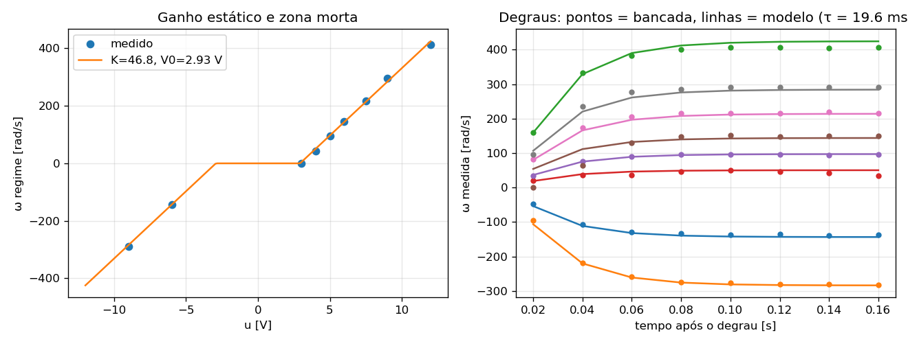
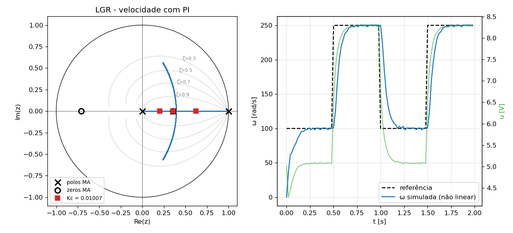
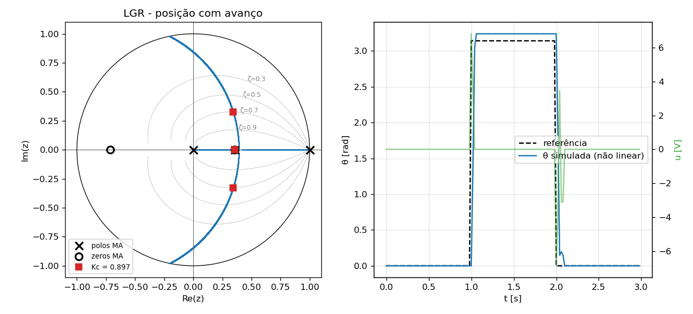
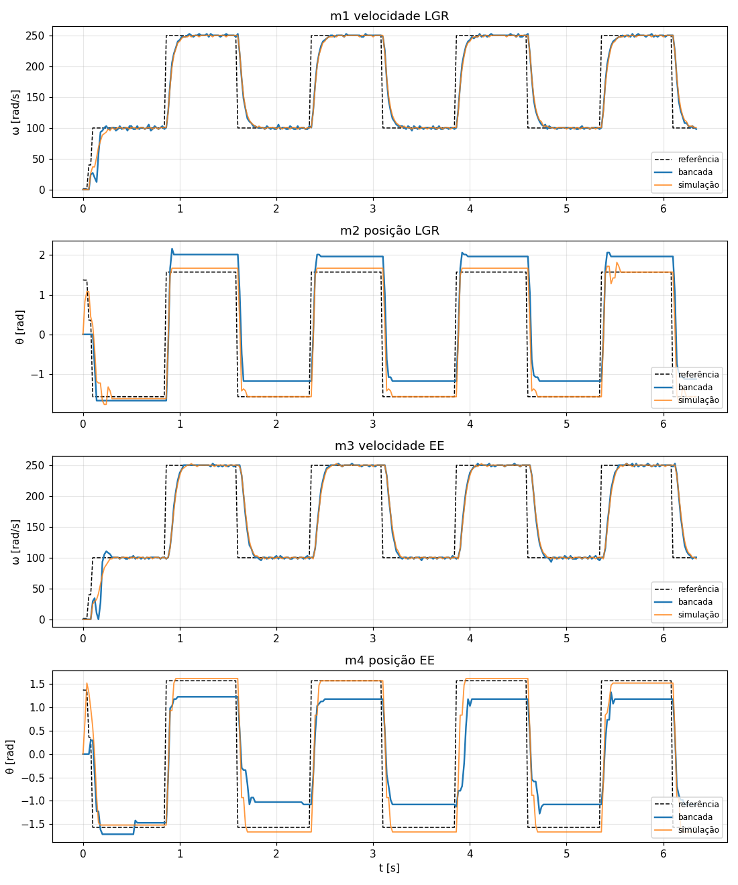

# 2. Etapa 1: identificação e projeto pelo LGR

Roteiro: **identificar a planta → discretizar → projetar no LGR → simular → testar na bancada →
comparar**. Cada passo tem um script em `projeto/`.

## 2.1 Identificação (malha aberta, modo m0)

**Por quê:** o LGR precisa de um modelo `G(s)`. Para um motor DC com indutância desprezível,
a velocidade segue um modelo de 1ª ordem, `W(s)/U(s) = K/(τs + 1)`. Falta medir K e τ.

**Como (no painel):**
1. Modo **m0** (u = referência, em volts).
2. Onda quadrada `0, V, 1000` (0 V ↔ V volts, 1 s em cada nível).
3. **● Gravar** por ~4 s e salvar como `dados/degrau_malha_aberta_<V>.csv`.
4. Repetir para V = 3, 4, 5, 6, 7.5, 9, 12, −6, −9.
5. `python projeto/identificacao.py`



**Resultado:**

| Parâmetro | Valor | Como foi obtido |
|---|---|---|
| K | **46,8 rad/s/V** | inclinação da reta ω_regime × u (gráfico da esquerda) |
| V0 | **2,93 V** | onde a reta cruza ω = 0: abaixo disso o motor não gira (atrito seco) |
| τ | **19,5 ms** | ajuste dos primeiros 160 ms de cada degrau (gráfico da direita) |

**Por que ajustar τ com o modelo da medida:** a velocidade é medida como média em 20 ms. Se
ajustarmos uma exponencial direto nos pontos, aparece um "atraso" falso de ~30 ms (1,5 amostra).
O script simula o motor e aplica a mesma média que o firmware faz, e com isso o ajuste fica
perfeito sem nenhum atraso real.

**Por que K é "incremental":** com atrito seco, `ω_regime = K(|u| − V0)`, que é uma reta que não
passa pela origem. O K que entra no modelo linear é a inclinação. O V0 é tratado à parte, pela
compensação de atrito do firmware.

> **Conclusão importante:** τ ≈ 20 ms é **igual** ao período de amostragem Ts = 20 ms.

## 2.2 Por que projetar direto no plano z

Projetar em s e depois discretizar (Tustin, "emulação") pressupõe que Ts é muito menor que as
constantes de tempo, tipicamente 10x menor. Aqui Ts ≈ τ: o motor praticamente chega ao regime
dentro de uma amostra. Então **discretizamos a planta** com ZOH (que é exato para um sinal que fica
constante entre amostras, exatamente o que o PWM faz) e fazemos o LGR em z.

## 2.3 Modelo discreto

Estado `x = [θ, ω]`, com `a = e^(−Ts/τ) = 0,357`:

```
x[k+1] = Φ x[k] + Γ u[k],   Φ = [1  τ(1−a)]    Γ = [K(Ts − τ(1−a))]
                                [0     a   ]        [   K(1−a)     ]
```

Funções de transferência resultantes (`planta.py`):

```
          Θ(z)     0,3515 z + 0,2500
Gθ(z) = ------ = ---------------------          (posição: polos em 1 e em a)
          U(z)     (z − 1)(z − 0,357)

          Ω_med(z)   17,58 z + 12,50
Gω(z) = -------- = -----------------           (velocidade MEDIDA)
           U(z)      z (z − 0,357)
```

**De onde vem o polo em z = 0 da velocidade:** a velocidade medida é `(θ[k] − θ[k−1])/Ts`, ou seja,
`Gω(z) = (1 − z⁻¹)/Ts · Gθ(z)`. O zero do derivador cancela o polo em z = 1 e deixa um polo em
z = 0, que é o atraso de "meia amostra" da medida por média.

## 2.4 Controle de velocidade: PI discreto (modo m1)

**Estrutura:**  `C(z) = Kc (z − zc)/(z − 1)`

* **Polo em z = 1 (integrador):** zera o erro em regime para degrau e rejeita perturbações
  constantes (como o atrito).
* **Zero em zc = a = 0,357:** cancela o polo da planta. O LGR fica só com os polos em 0 e 1, e a
  escolha do ganho fica simples.

**Escolha de Kc:** pelo LGR, escolhemos o ganho que coloca o polo dominante em **z = 0,62**, o que
equivale a uma constante de tempo de −Ts/ln(0,62) ≈ 42 ms e a uma acomodação de ≈ 0,13 s, sem
sobressinal (polos reais).



```
Kc = 0,01007     polos de malha fechada: 0,62 ; 0,203 ; (0,357 cancelado)
C(z) = 0,01007 (z − 0,357)/(z − 1)   ->   comando:  cv 0.010070,-0.003592,0,-1,0
```

**Como C(z) vira o comando `cv`:** dividindo por z, `C(z) = (b0 + b1 z⁻¹)/(1 + a1 z⁻¹)` com
`b0 = Kc`, `b1 = −Kc·zc` e `a1 = −1`. No firmware isso é a equação a diferenças
`u[k] = u[k−1] + b0 e[k] + b1 e[k−1]`.

> **Validação curiosa:** o PI que estava no firmware original da bancada era
> `u[k] = u[k−1] + 0,01 e[k] − 0,0035 e[k−1]`, praticamente o mesmo que saiu deste projeto. Isso
> indica que o modelo identificado está certo.

**Anti-windup:** quando u satura em ±12 V, o firmware guarda o valor **já saturado** em `u[k−1]`.
Assim o integrador não acumula um valor que o motor não consegue aplicar e não há "estouro" na
volta.

## 2.5 Controle de posição: compensador de avanço (modo m2)

A planta de posição já tem um integrador (polo em z = 1). Por isso um simples ganho já daria erro
zero para degrau *no modelo linear*. O que limita a velocidade de resposta é o polo em z = a.

**Estrutura:**  `C(z) = Kc (z − a)/(z − p)`, com p = 0

* o zero cancela o polo da planta em a = 0,357;
* o polo do compensador em p = 0 (mais rápido) o substitui. É um **avanço de fase**: a resposta fica
  mais rápida sem perder amortecimento.

**Escolha de Kc:** pelo LGR, o ganho que dá **ζ = 0,7** (curvas pontilhadas de ζ constante).



```
Kc = 0,897    polos: 0,342 ± 0,327j  (≡ s = −37 ± 38j: ωn ≈ 53 rad/s, ζ = 0,70, ts ≈ 0,11 s)
C(z) = 0,897 (z − 0,357)/z    ->   comando:  cp 0.897,-0.319938,0,0,0
```

## 2.6 O atrito seco e a compensação

Com Kc = 0,897 V/rad, um erro de 1 rad gera só 0,9 V, bem abaixo dos ~3 V que vencem o atrito. Sem
compensação o motor pararia muito antes do alvo. Por isso o firmware:

1. soma **`zm` = 3,0 V** no sentido de u quando o motor está girando e **`zs` = 4,0 V** quando está
   parado (o atrito estático é maior que o dinâmico);
2. desliga o controle de posição quando |erro| < **`bp` = 0,1 rad** (banda morta). Sem isso, a
   compensação faria o motor "caçar" o alvo indefinidamente.

**Por que isso não "estraga" o projeto linear:** a compensação cancela (aproximadamente) a
não linearidade. Do ponto de vista do controlador, a planta volta a ser `K/(τs+1)`, que é a
hipótese usada no LGR.

## 2.7 Simulação x bancada

`python projeto/compara.py` simula cada ensaio gravado com o modelo **não linear**: atrito estático
e dinâmico, saturação, quantização do encoder e medida por média. A simulação usa **a mesma
referência gravada**.



* **Velocidade (m1):** simulação e bancada praticamente coincidem: acomodação ≈ 0,14 s, sobressinal
  ≈ 2 %, erro em regime < 1 rad/s.
* **Posição (m2):** rápida, mas cada degrau para num ponto diferente (erro de 0 a 0,4 rad). O
  atrito estático desta bancada **varia com o ângulo do eixo**, e o avanço não tem integrador para
  corrigir o erro que sobra. Esse ponto se resolve na Etapa 2.

## 2.8 Fazendo o mesmo no MATLAB (se a disciplina pedir)

```matlab
K = 46.75; tau = 0.0194; Ts = 0.02;
G  = tf(K, [tau 1]);                  % velocidade
Gt = tf(K, [tau 1 0]);                % posição
Gz  = c2d(G,  Ts, 'zoh');
Gtz = c2d(Gt, Ts, 'zoh');
a = exp(-Ts/tau);
% velocidade medida = (1 - z^-1)/Ts * posição
Gwz = minreal(tf([1 -1], [Ts 0], Ts) * Gtz);
rlocus(tf([1 -a],[1 -1],Ts) * Gwz); zgrid      % PI
rlocus(tf([1 -a],[1 0],Ts)  * Gtz); zgrid      % avanço
```

Use `rlocfind` (ou clique no gráfico) para escolher o ganho e compare com os valores acima.
