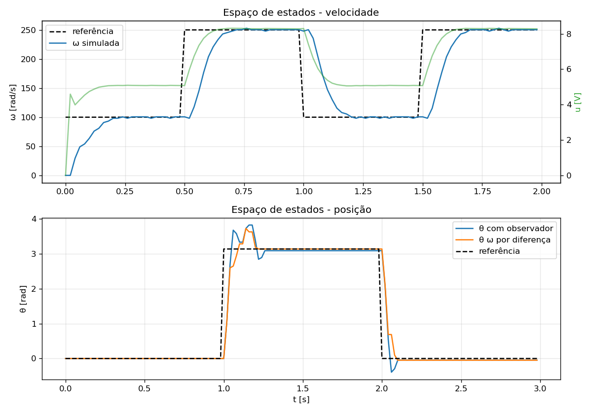
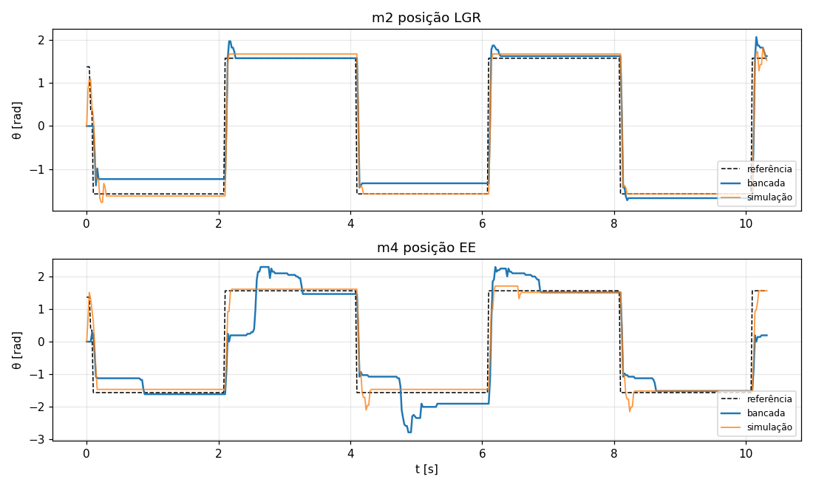

# 3. Etapa 2: projeto em espaço de estados

Mesmos objetivos da Etapa 1 (velocidade e posição), agora com **realimentação de estados**
`u = −K x`, ganhos calculados por **alocação de polos** (fórmula de Ackermann) no modelo discreto.
Script: `projeto/espaco_estados.py`.

## 1. Por que acrescentar um integrador

Realimentação de estados pura (`u = −Kx + N̄ r`) só dá erro zero se o modelo for perfeito. Qualquer
diferença (atrito, K um pouco diferente, carga) vira erro em regime. A solução clássica é
**aumentar o estado com a integral do erro**:

```
xi[k+1] = xi[k] + Ts · (r[k] − y[k])
```

e realimentar também `xi`. É o equivalente, em espaço de estados, ao "I" do PI.

## 2. Velocidade (modo m3)

**Modelo** (1 estado, ZOH): `ω[k+1] = a ω[k] + b u[k]`, com `a = 0,357` e `b = K(1−a) = 30,07`.

**Sistema aumentado** `x = [ω, xi]`:

```
[ω ]        [ a   0 ] [ω ]   [b]          [0 ]
[xi][k+1] = [−Ts  1 ] [xi] + [0] u[k]  +  [Ts] r[k]
```

**Polos escolhidos:** s = −25 e −30 rad/s → **z = 0,607 e 0,549** (z = e^(s·Ts)). Ficam próximos do
polo dominante do PI da Etapa 1 (0,62), para os dois projetos serem comparáveis.

**Ackermann** dá `K_aum = [k1, −ki]` tal que `eig(A − B·K_aum)` são os polos desejados:

```
u = −k1 ω + ki xi        k1 = 0,006694    ki = 0,295139
comando:  ev 0.006694,0.295139,0
```

O terceiro número (`nv`) é uma pré-alimentação opcional `nv·r`. Com integrador ela não é
necessária para erro zero, mas pode acelerar a resposta. Fica como experimento.

**Anti-windup (integração condicional):** se u saturou *e* o erro está empurrando no mesmo
sentido da saturação, o firmware **não integra** naquele passo.

**Resultado:** praticamente idêntico ao PI (acomodação ≈ 0,16 s, sobressinal ≈ 2 %). Faz sentido:
com um estado + integrador, a realimentação de estados **é** um PI, só que projetado de outro jeito.
Esse é um bom ponto para o relatório.

## 3. Posição (modo m4)

**Modelo** `x = [θ, ω]` (ZOH, ver [02](02-identificacao-e-lgr.md#23-modelo-discreto)), aumentado
com `xi` (integral de r − θ) → 3 estados.

**Polos escolhidos:**
* par dominante **ζ = 0,9, ωn = 40 rad/s** → z = 0,458 ± 0,166j (bem amortecido, para evitar
  sobressinal: passar do alvo e ter que voltar contra o atrito é ruim);
* polo do integrador **s = −4** → z = 0,923, **lento de propósito** (ver a seção 5).

```
u = k1 (r − θ) − k2 ω + ki xi     k1 = 0,650   k2 = 0,00965   ki = 2,058
comando:  ep 0.649985,0.009648,2.057968
```

**Por que `k1·(r − θ)` e não `−k1·θ`:** a planta de posição já tem integrador. Multiplicar a
referência por `N̄ = k1` garante ganho estático 1 mesmo sem o integrador `xi`, e a resposta ao
degrau fica mais rápida (o "chute" inicial vem de `k1·r`, sem esperar o integrador carregar).

## 4. Observador de estados (opcional, `oe 1`)

A velocidade medida por diferença é ruidosa (resolução de 2,45 rad/s) e atrasada (média no
intervalo). Um **observador** estima `[θ̂, ω̂]` a partir do modelo e da posição medida:

```
x̂[k+1] = Φ x̂[k] + Γ u[k] + L (θ[k] − θ̂[k])
```

Os ganhos L vêm de Ackermann aplicado ao sistema dual `(Φᵀ, Cᵀ)`, com polos **z = 0,25 e 0,30**
(mais rápidos que a malha, como manda a regra):

```
L1 = 0,8067   L2 = 0,4844      comandos:  ob 0.806676,0.484432   pl 46.75,0.0194   oe 1
```

O observador recebe o u **antes** da compensação de atrito, porque a compensação existe para
cancelar o atrito e o modelo do observador não tem atrito.



## 5. O que aconteceu na bancada e por quê



**Velocidade (m3):** funciona como projetado, e simulação e bancada coincidem
([figura](figuras/comparacao_bancada.png)).

**Posição (m4):** o integrador **corrige** o erro que o atrito deixa. Depois de ~1–2 s o erro cai
para 0,05–0,1 rad (1 a 2 contagens do encoder). O avanço da Etapa 1 (m2) fica parado onde o atrito
deixou (0 a 0,34 rad no mesmo ensaio). Por outro lado:

* **Stick-slip:** enquanto o motor está preso, o integrador vai carregando. Quando a tensão vence o
  atrito estático, o motor "escapa" e às vezes passa do alvo. Por isso o polo do integrador é
  lento (s = −4): com integradores rápidos (testamos s = −15) o sobressinal era de mais de 100 %.
* **O atrito estático desta bancada varia com o ângulo** (de ~3,5 V a ~5 V, conforme o ponto). Por
  isso ensaios iguais dão resultados um pouco diferentes. Isso é do sistema real, não é erro do
  projeto.
* **Observador:** na simulação ele ajuda. Na bancada, com atrito variável, o modelo do observador
  fica errado justamente perto do repouso (ele "acha" que o motor está girando quando está preso),
  e o desempenho piorou. Por isso ele vem **desligado** (`oe 0`). Vale mostrar os dois casos no
  relatório (`oe 1` × `oe 0`).
* Ganhos mais agressivos (ωn = 50, integrador em −8) às vezes deram respostas excelentes e às vezes
  oscilação mantida. A escolha final privilegia **repetibilidade**.

**Sugestões para o relatório (comparação Etapa 1 × Etapa 2):**

| Critério | LGR (m1/m2) | Espaço de estados (m3/m4) |
|---|---|---|
| Velocidade | PI, 2 parâmetros, ótimo | equivalente a um PI, mesmo desempenho |
| Posição: rapidez | muito rápida (avanço) | um pouco mais lenta |
| Posição: erro com atrito | fica onde parou | integrador zera (devagar) |
| Projeto | gráfico, intuitivo, 1 ganho por vez | todos os polos de uma vez, sistemático |
| Medição de ω | não precisa | precisa de ω: diferença ou observador |

## 6. Experimentos que vale a pena fazer

1. `oe 1` × `oe 0` no m4 (efeito do observador com atrito).
2. `zs 0` e `zm 0` (sem compensação de atrito): mostra por que ela é necessária.
3. `bp 0` (sem banda morta): o motor fica "caçando" o alvo.
4. Mudar `POS_POLO_INTEGRADOR_S` em `espaco_estados.py` para −10 ou −15 e ver o stick-slip aumentar.
5. `ev` com `nv ≠ 0`: efeito da pré-alimentação.
