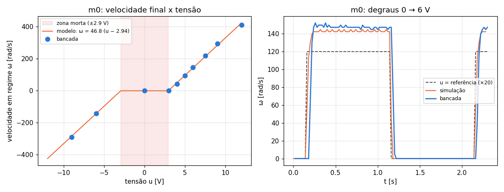
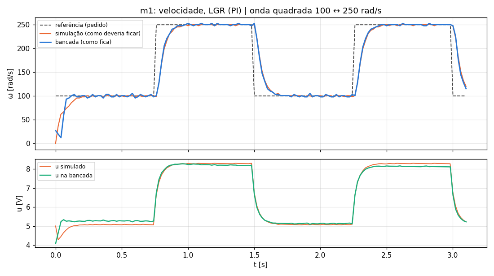
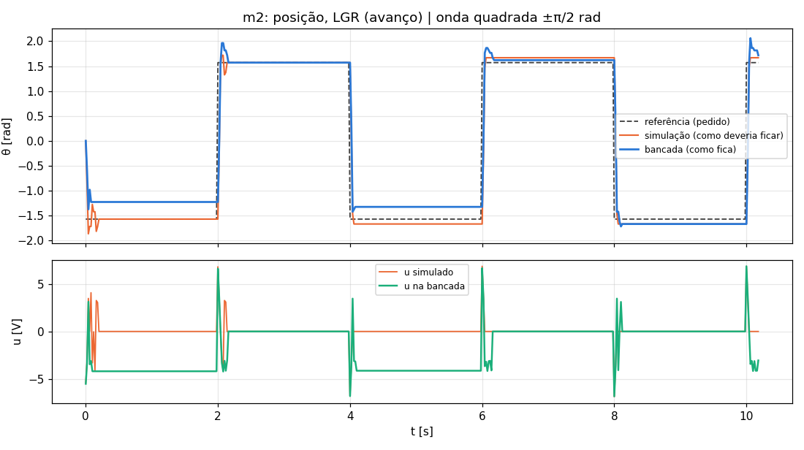
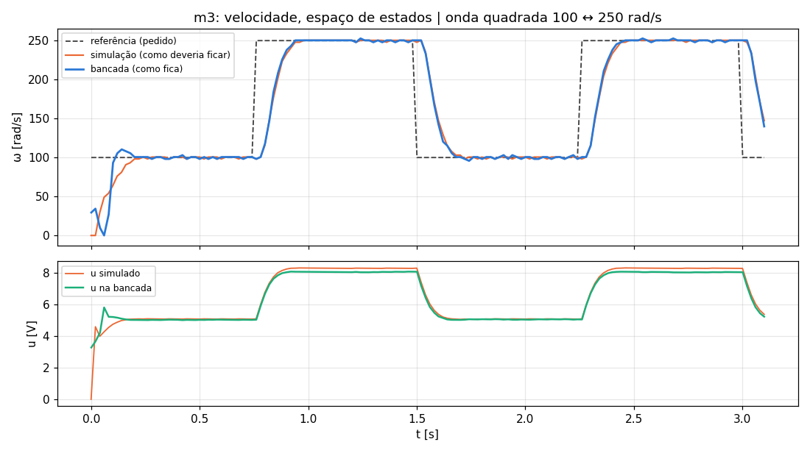
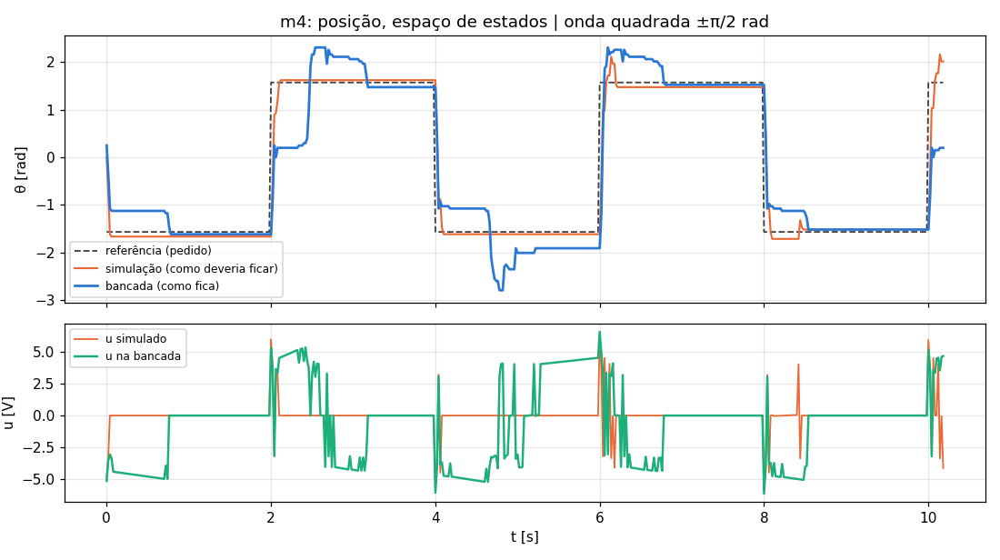
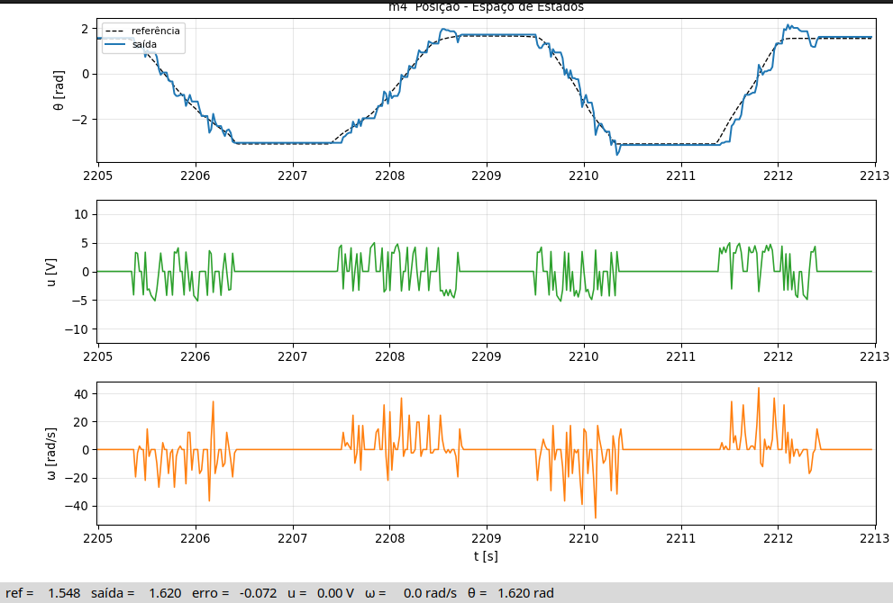
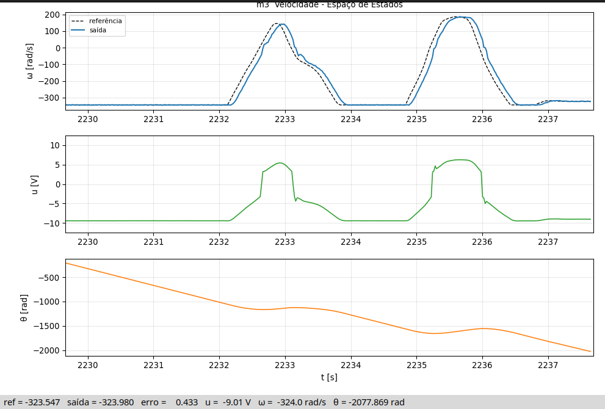

# 5. Os modos m0 a m4: o que fazem e o que esperar

Este documento explica, modo a modo, **o que o firmware faz**, **o que o potenciômetro controla**,
**como a onda deveria ficar** (simulação com o modelo da planta) e **como ela fica de verdade**
(ensaio gravado nesta bancada). O firmware tem **5 modos, de m0 a m4** (não existe m5).

As figuras são geradas por [`projeto/figuras_modos.py`](../projeto/figuras_modos.py) a partir dos
ensaios em [`dados/`](../dados). Em todas:

* **tracejado preto** = referência (o que foi pedido);
* **laranja** = simulação com o modelo não linear de [`projeto/planta.py`](../projeto/planta.py)
  (atrito seco, saturação e encoder incluídos): **como deveria ficar**;
* **azul** = bancada: **como fica**;
* gráfico de baixo = **u**, a tensão aplicada no motor.

## Resumo

| Modo | Controla | Potenciômetro define | Malha | Método | Resultado na bancada |
|---|---|---|---|---|---|
| m0 | tensão | −12 … +12 V | aberta | nenhum (u = ref) | parado abaixo de ~2,9 V; acima disso ω ≈ 46,8·(u − 2,94) rad/s |
| m1 | velocidade | −350 … +350 rad/s | fechada | LGR, PI | acomoda em ~0,14 s, sobressinal ~2 %, erro < 1 rad/s |
| m2 | posição | −π … +π rad | fechada | LGR, avanço | rápido (~0,1 s), mas pode parar até ~0,35 rad antes do alvo |
| m3 | velocidade | −350 … +350 rad/s | fechada | espaço de estados | igual ao m1 (~0,16 s, ~2 %) |
| m4 | posição | −π … +π rad | fechada | espaço de estados + integrador | chega mais perto do alvo, mas devagar e aos trancos |

### Como o potenciômetro vira referência

O potenciômetro é um divisor de tensão ligado em 0 V e 5 V, com o cursor no pino A6. A placa lê
0…4095 e converte para **−1…+1, com o zero no meio do curso**. Depois multiplica pela faixa do
modo (±12 V, ±350 rad/s ou ±π rad). O **sinal define o sentido de giro**: positivo aciona o pino
D10 da ponte H, negativo aciona o D9, e a corrente no motor se inverte. Por isso o motor gira para
um lado de um lado do meio e para o outro lado do outro.

### Como ler a telemetria (terminal)

Cada linha, a cada 20 ms: `t_ms,modo,referencia,u,velocidade,posicao`.

```
1502,1,250.000,8.219,247.89,206.5106
 │   │    │      │      │       └─ θ: posição acumulada do eixo (rad; 1 volta = 6,28 rad)
 │   │    │      │      └─ ω: velocidade medida (rad/s)
 │   │    │      └─ u: tensão aplicada (V, −12…+12)
 │   │    └─ referência: V no m0, rad/s no m1/m3, rad no m2/m4
 │   └─ modo (0…4)
 └─ tempo desde que a placa ligou (ms)
```

Linhas que começam com `#` são mensagens: `#ok m1` confirma um comando; `?` lista os parâmetros.

### Os três gráficos do painel

| Gráfico | m0, m1, m3 | m2, m4 |
|---|---|---|
| 1º | ω (pedido tracejado, real em azul) | θ (pedido tracejado, real em azul) |
| 2º | u [V] | u [V] |
| 3º | θ | ω |

---

## m0: malha aberta

**O que faz:** aplica no motor exatamente a tensão pedida (`u = referência`). Não mede nada para
corrigir. Se você frear o eixo com a mão, ninguém compensa.

**Para que serve:** identificar a planta. Foi daqui que saíram K = 46,75 rad/s/V, τ = 19,4 ms e o
atrito seco V0 = 2,94 V ([02-identificacao-e-lgr.md](02-identificacao-e-lgr.md)).



**Como deveria ficar:** reta `ω = K·(u − V0)` fora da zona morta e ω = 0 dentro dela. Num degrau,
a velocidade sobe como uma exponencial de constante τ ≈ 19 ms, ou seja, chega ao valor final em
~0,06 s.

**Como fica:** os pontos medidos caem em cima da reta (à esquerda). No degrau de 6 V (à direita),
a bancada chega a ~147 rad/s e a simulação a ~143 rad/s, com a mesma rapidez. Com 3 V o motor
**não gira**: é a zona morta.

**O que você vê no painel:** perto do meio do potenciômetro (|u| < ~3 V) nada acontece. Acima
disso a velocidade cresce proporcional à tensão. No 1º e no 2º gráfico, referência e u são a mesma
curva.

```
1600,0,6.000,6.000,149.72,63.2736      ← pediu 6 V, aplicou 6 V, girando a ~150 rad/s
```

---

## m1: velocidade, LGR (PI)

**O que faz:** a cada 20 ms mede ω, calcula o erro `e = r − ω` e aplica um PI discreto,
`C(z) = 0,01007 (z − 0,357)/(z − 1)`, projetado pelo Lugar Geométrico das Raízes. O "P" reage ao
erro do momento; o "I" acumula o erro até zerá-lo. O firmware também soma a compensação de atrito
(`zm`/`zs`), para o controlador "enxergar" uma planta linear.



**Como deveria ficar:** ω alcança a referência em ~0,14 s, com sobressinal de ~2 % e erro em
regime zero (graças ao integrador).

**Como fica:** **praticamente igual à simulação.** Em regime, u ≈ 5,3 V para 100 rad/s e ≈ 8,2 V
para 250 rad/s. A curva azul "treme" em passos de 2,45 rad/s: é a resolução do encoder
(1 contagem a cada 20 ms), não erro do controle.

**Experimente:** freie o eixo levemente com o dedo. ω cai um pouco, u sobe sozinho e ω volta para
a referência.

```
1502,1,250.000,8.219,247.89,206.5106   ← pediu 250 rad/s, está a 247,9 com 8,2 V
```

---

## m2: posição, LGR (avanço)

**O que faz:** mede θ e aplica um compensador de avanço, `C(z) = 0,897 (z − 0,357)/z`. O eixo se
comporta como um servo: vai até o ângulo pedido e para. Quando |erro| < 0,1 rad (`bp`), o controle
desliga, para o motor não ficar "caçando" o alvo.

> Antes de usar o m2 ou o m4, clique em **Zerar posição (z)**. Sem isso, o controle tenta
> "desenrolar" todas as voltas acumuladas desde que a placa ligou.



**Como deveria ficar:** o eixo chega ao alvo em ~0,1 s, com um pequeno sobressinal, e para.

**Como fica:** o movimento é rápido como o previsto, mas **em t ≈ 0 s e t ≈ 4 s o eixo parou
antes do alvo** (erro de 0,25 a 0,35 rad), com u ≈ −4,2 V "empurrando" sem conseguir mover. O
atrito estático desta bancada varia de 2,4 V a 5,7 V conforme o ângulo
([figura](figuras/atrito_estatico.png)), e o avanço **não tem integrador** para aumentar a tensão
até vencê-lo. Nos outros degraus ele chegou a menos de 0,1 rad.

```
2041,2,-1.571,-4.198,0.00,-1.2272      ← pediu −1,571 rad, parou em −1,227 com −4,2 V: preso pelo atrito
```

---

## m3: velocidade, espaço de estados

**O que faz:** mesmo objetivo do m1, outro método (Etapa 2). Realimentação de estado mais um
integrador do erro: `u = −k1·ω + ki·∫(r − ω) dt`, com k1 = 0,00669 e ki = 0,295. Os polos foram
alocados (Ackermann) no mesmo lugar do polo dominante do PI, para os dois serem comparáveis
([03-espaco-de-estados.md](03-espaco-de-estados.md)).



**Como deveria ficar / como fica:** igual ao m1 (acomodação ~0,16 s, sobressinal ~2 %, erro
< 1 rad/s), e bancada e simulação coincidem. A diferença para o m1 está em u no instante do
degrau: aqui a referência entra só pelo integrador, então u sobe de forma mais suave.

```
1502,3,250.000,8.044,250.35,199.8347
```

---

## m4: posição, espaço de estados

**O que faz:** `u = k1·(r − θ) − k2·ω + ki·∫(r − θ) dt`, com k1 = 0,650, k2 = 0,00965 e
ki = 2,06. Usa posição **e** velocidade, mais um integrador. Tem um observador opcional que estima
a velocidade a partir do modelo; ele vem desligado (`oe 0`) e o comando `oe 1` liga.



**Como deveria ficar:** a simulação (com atrito fixo) chega perto do alvo em ~0,2 s e para.

**Como fica:** aqui bancada e simulação **diferem bastante**. Quando o eixo para antes do alvo,
o integrador vai aumentando u até o motor "descolar". Ele então dá um tranco e muitas vezes passa
do alvo (em t ≈ 2,5 s chegou a 2,3 rad para um alvo de 1,57). Isso é o **stick-slip**: o atrito
estático real varia com o ângulo e é bem maior que o atrito em movimento, coisa que o modelo com
atrito fixo não reproduz. Quando acerta, o erro final fica em ~0,05 rad, menor que no m2. Mas leva
de 1 a 2 s e nem sempre converge dentro do patamar (em t ≈ 4–6 s ficou a 0,34 rad).

```
8042,4,1.571,0.000,0.00,1.5217         ← chegou a 0,05 rad do alvo e desligou (dentro da banda de 0,1 rad)
```

---

## Seguindo o potenciômetro ao vivo: o que observar

As figuras acima usam ondas quadradas. Abaixo estão dois registros do painel com a referência
vindo do **potenciômetro**, girado à mão de uma ponta à outra.

### m4: posição seguindo o potenciômetro



* **θ (azul) acompanha a referência (tracejado), mas em degraus.** O eixo "gruda", o erro cresce,
  o controle aumenta u até ele descolar, e ele anda de tranco. É o mesmo stick-slip da onda
  quadrada, agora em câmera lenta.
* **u só aparece enquanto o potenciômetro se move.** São rajadas de ±5 V (controle mais
  compensação de atrito). Com o potenciômetro parado e o erro menor que 0,1 rad (`bp`), **u = 0**
  e o motor fica desligado. Na linha de baixo: ref = 1,548, θ = 1,620, erro = −0,072 rad (4°),
  u = 0. Está dentro da tolerância, então o comportamento está correto.
* **ω (3º gráfico) só tem picos curtos**, de ±40 rad/s: são os trancos.
* **A faixa vai de −3,1 a +1,55 rad, e não de −π a +π.** Veja a observação sobre o potenciômetro
  logo abaixo.

### m3: velocidade seguindo o potenciômetro



* **ω (azul) segue a referência com um atraso de ~0,1 s.** É a acomodação de ~0,16 s vista no
  degrau, aplicada a uma referência que muda continuamente.
* **u acompanha a velocidade:** cerca de −9 V para −324 rad/s e +6 V para +190 rad/s. Pelo modelo,
  ω ≈ 46,8·(u − 2,94), então 324 rad/s precisam de ~9,9 V. A diferença é a compensação de atrito e
  o integrador.
* **θ (3º gráfico) desce sem parar:** em velocidade o eixo gira continuamente e a posição acumula
  voltas (−2 078 rad ≈ 330 voltas). Por isso, **ao trocar de m3 para m4 o motor demora a parar**:
  ele "desenrola" essas voltas até chegar ao ângulo do potenciômetro. Clique em **Zerar posição (z)**
  ao passar de um modo de velocidade para um de posição.
* Erro na linha de baixo: 0,43 rad/s em 324 rad/s (0,1 %).

### Observação: o lado positivo do potenciômetro não chega ao fim da faixa

Nos dois registros, o lado **negativo** chega perto do máximo (−3,1 de −3,14 rad, e −323 de
−350 rad/s). Já o **positivo** para em cerca da **metade** (+1,55 de +3,14 rad, e +190 de
+350 rad/s). Isso indica que, na ponta "positiva", o cursor do potenciômetro não chega a 0 V
(lê ~1 000 em vez de 0, na escala de 0 a 4095). Consequências:

* o **meio físico** do potenciômetro não corresponde à referência zero (fica em torno de −25 % da
  faixa), e é por isso que "o zero não está no meio";
* no m2/m4 só dá para pedir até ~+π/2 rad no sentido positivo; no m1/m3, até ~+175 rad/s.

O código não está errado: ele assume que o potenciômetro vai de 0 V a 5 V. A correção é
**calibrar** as duas pontas (ler o valor real em cada uma e mapear essa faixa para −1…+1), mais
uma pequena zona neutra no centro. Para medir, use o **m0**, gire até cada ponta e anote o valor de
`ref` no painel.

---

## Conclusão: o que comparar no relatório

* **Velocidade (m1 × m3):** os dois métodos dão a mesma resposta, e a simulação prevê a bancada
  muito bem. O modelo de 1ª ordem com compensação de atrito é suficiente.
* **Posição (m2 × m4):** quem domina é o **atrito estático**. Sem integrador (m2) o eixo é rápido,
  mas para onde o atrito deixar. Com integrador (m4) chega mais perto do alvo, ao custo de
  lentidão e trancos. A rampa de partida (`zr`, que sobe a compensação enquanto o motor está preso)
  e o script [`projeto/teste_posicao.py`](../projeto/teste_posicao.py), que testa vários alvos
  aleatórios, servem para estudar esse compromisso.

## Como reproduzir

Pelo painel (`python interface/painel.py`): escolha o modo, clique em **Zerar posição (z)** se for
posição, e use **Enviar onda quadrada** com os valores padrão de cada modo (100 ↔ 250 rad/s, ou
±1,5708 rad). Use **⏸ Pausar gráfico** para voltar no tempo e **Salvar trecho visível** para
guardar o ensaio em CSV.

Pela linha de comando (sem o painel):

```bash
cd projeto
python ensaio.py "m1;q100,250,750" 6 -o ../dados/meu_m1.csv
python ensaio.py "z;m2;q-1.5708,1.5708,2000" 10 -o ../dados/meu_m2.csv
python compara.py ../dados/meu_m1.csv      # sobrepõe simulação e bancada
python figuras_modos.py                    # refaz as figuras deste documento
```
